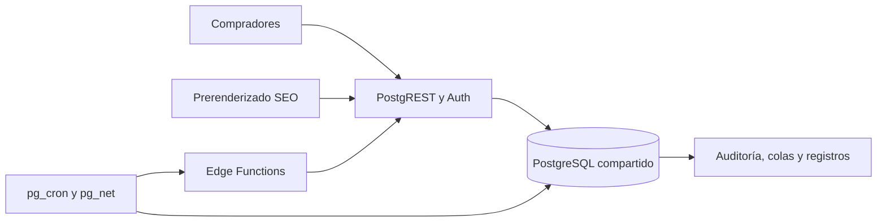

# Auditoría profunda de Supabase y acceso a datos — Collectibles

Fecha: 14 de octubre de 2026. Zona horaria: America/Montevideo, UTC−3.  
Proyecto: `cobtsgkwcftvexaarwmo`, `collectibles2026`, región `us-west-2`.  
Alcance: diagnóstico de solo lectura; no se cambiaron tablas, índices, políticas, cron, funciones desplegadas ni código de la aplicación.

## Dictamen

**No hay evidencia suficiente para justificar una migración completa de base de datos como primera medida. Sí hay evidencia suficiente para una intervención urgente de capacidad, disponibilidad, seguridad y acceso a datos.**

El incidente afectó PostgreSQL y su capa de acceso: fallaron autenticaciones, conexiones locales del pooler y operaciones básicas de inicialización de PostgREST. En paralelo, hay defectos concretos que agregan trabajo y dificultan la recuperación. Corregir esos defectos es necesario incluso si después se decide cambiar de proveedor.

La explicación de trabajo mejor respaldada es una degradación persistente de recursos o del estado de los servicios, sobre infraestructura Free, amplificada por solicitudes que permanecen abiertas y procesos que comparten la misma base. **El recurso desencadenante —RAM, CPU, disco, conexiones o bloqueo— todavía no está demostrado.** No se presenta esta hipótesis como una causa raíz cerrada.

El usuario confirmó que la recuperación requiere reiniciar la base o el proyecto. Ese reinicio puede liberar sesiones, memoria, bloqueos y procesos; no identifica por sí mismo cuál de ellos provocó la degradación.

## 1. Qué se pudo comprobar y con qué límites

Se revisaron:

- El informe aportado por el usuario.
- Metadatos de producción: proyecto, plan de la organización, 259 tablas públicas, 181 entradas del historial de migraciones, extensiones y despliegues de Edge Functions.
- Los dos grupos de asesores de Supabase: rendimiento y seguridad.
- Registros de PostgreSQL, PgBouncer, PostgREST, gateway y Edge Functions. La ventana comparable principal es **09:00–18:00 de Uruguay**, equivalente a **12:00–21:00 UTC**. Se consultó además un panorama horario más amplio del día.
- El código de catálogo, filtros, búsqueda, cachés, prerenderizado SEO, administración, workers y migraciones.
- El código efectivamente desplegado de `ml-import-worker` v10, `campaign-runner` v9 y `zinc-sync-order-tracking` v1.
- Navegación pública: el catálogo mostró **1.205 productos** y la búsqueda `Pokemon` mostró **125 resultados**. Son observaciones funcionales puntuales, no pruebas de carga ni una garantía de estabilidad.

Clasificación usada: **producción** = metadatos o registros consultados; **código** = comportamiento verificable en el repositorio o fuente desplegada; **aportado** = dato del informe inicial no recapturado; **pendiente** = falta una medición necesaria.

La herramienta de SQL directo exige aprobación y esta sesión tiene la política `never`; incluso una consulta SELECT fue rechazada antes de ejecutarse. La CLI enlazada no tiene un token de acceso autenticado. Por eso no se obtuvieron `pg_stat_activity`, `pg_locks`, planes EXPLAIN, tamaños reales, autovacuum, límites efectivos ni un inventario actual de cron por SQL.

La sonda HTTP desde la terminal falló por DNS local (`ENOTFOUND`). **Ese resultado no demuestra una caída de Supabase y no se utilizó como medición de latencia.** El navegador sí permitió comprobar contenido público.

Los resultados `rows` de `list_tables` muestran cero en muchas tablas aunque el catálogo público contiene productos. No se interpretaron como conteos exactos, borrado de datos ni prueba de que las tablas estén vacías. Hay que comprobar el origen y la fecha de las estadísticas.

Evidencia estructurada: [AUDITORIA_SUPABASE_2026-10-14_EVIDENCIA.json](./AUDITORIA_SUPABASE_2026-10-14_EVIDENCIA.json). Se excluyeron credenciales y datos de clientes. Los fragmentos de consultas están redactados.

## 2. Magnitud real del incidente

### 2.1 Disponibilidad de la API

En los registros observados de la ventana de nueve horas:

| Indicador | Resultado |
| --- | ---: |
| Solicitudes a `/rest/v1/` | 2.580 |
| Respuestas HTTP 5xx de esas solicitudes | 713 |
| Proporción 5xx observada | **27,64 %** |
| HTTP 504 | 233 |
| HTTP 522 | 454 |
| HTTP 524 | 9 |
| HTTP 503 | 15 |
| HTTP 500 | 2 |

Es una proporción de solicitudes registradas, no de clientes únicos ni una estimación anual de disponibilidad. Tampoco todos los 5xx tienen necesariamente la misma causa.

| Ruta / estado | Solicitudes | Mediana del tiempo de origen | p95 del tiempo de origen |
| --- | ---: | ---: | ---: |
| Productos / 200 | 405 | 351 ms | 1.209 ms |
| Productos / 522 | 184 | 90.054 ms | 90.259 ms |
| Productos / 504 | 59 | 5.207 ms | 5.307 ms |
| Imágenes / 522 | 142 | 90.046 ms | 90.106 ms |
| Renovación de sesión `/auth/v1/token` / 504 | 163 | 5.224 ms | 5.451 ms |

Los tiempos provienen de `response.origin_time`: incluyen la espera del origen y no equivalen al tiempo de ejecución SQL. El p95 de los éxitos debe mostrarse junto con los fallos: publicar solo la latencia de respuestas 200 ocultaría gran parte del incidente.

También hubo dos respuestas 504 en `/auth/v1/authorize` y una 520 en `/auth/v1/token`. El alcance incluye la autenticación, además del catálogo.

### 2.2 Cronología en hora uruguaya

| Hora | Evidencia |
| --- | --- |
| 10:54:09 | Primer 504 REST observado en la ventana |
| 10:54:20 | Primer `statement timeout` PostgreSQL: consulta del monitor `postgres_exporter` sobre `pg_stat_activity` |
| 10:54:22 | Primer 524 REST observado |
| 10:55 aprox. | Inicio de los fallos cron, según el informe aportado |
| 11:01:44 | Primer 522 REST observado |
| 11:29:02 | FATAL: cancelación de autenticación por timeout |
| 11:30:54 | FATAL: pérdida de conexión con cliente |
| 12:15:14 | Segunda cancelación FATAL de autenticación |
| 16:12:57 | PostgREST registra inicialización de un pool con máximo de 10 conexiones |
| 16:17:14–16:19:04 | Otras tres inicializaciones del pool |
| 16:18:48 | Último 503 REST de esa secuencia |
| 16:43 y 17:57 | Persisten dos fallos 500 posteriores, con cancelaciones de consultas concretas |

La recuperación general coincide con reinicializaciones de PostgREST. No se dispone de la hora exacta de la intervención manual del usuario ni del registro de arranque de PostgreSQL para atribuir cada evento a un reinicio determinado.

La primera cancelación PostgreSQL observada pertenece al monitor interno. **No corresponde atribuir el comienzo del incidente a una consulta de categorías solo por ser costosa en estadísticas acumuladas.**

### 2.3 Qué fallaba dentro de PostgreSQL

Se confirmaron las cifras del informe, con una distinción de severidad:

| SQLSTATE | ERROR | FATAL | LOG | Interpretación |
| --- | ---: | ---: | ---: | --- |
| `57014` | 69 | 2 | 0 | 53 statement timeouts, 16 cancelaciones por petición del cliente y 2 timeouts de autenticación |
| `22P02` | 23 | 0 | 0 | Identificadores de producto que no tienen formato UUID |
| `08006` | 0 | 1 | 12 | Pérdidas y resets de conexión |

Los **92 ERROR + 3 FATAL** no incluyen los 12 eventos registrados como LOG. Esto explica por qué sumar las columnas por código produce otra cifra.

Entre las operaciones canceladas de PostgREST aparecen:

- Inicialización de `client_encoding` y `client_min_messages`: 20 eventos.
- Establecimiento del contexto de la petición con `set_config`: 10.
- Lectura de configuración y versión: 5.
- `BEGIN ... READ ONLY`: 4.
- Lectura de configuración de roles y reconstrucción de caché de esquema.
- Después de la recuperación general, consultas de productos e imágenes.

Además, PgBouncer registró **152 mensajes de connect timeout** y **6 de query_wait_timeout**. Algunos timeouts de conexión ocurrieron al conectar con PostgreSQL en `127.0.0.1:5432`.

Esto demuestra que la degradación alcanzó la comunicación local entre servicios. La distancia entre Uruguay y la región de AWS puede agregar latencia habitual, pero no explica por sí sola los timeouts de conexiones locales ni que fallen instrucciones de inicialización.

No aparecieron mensajes explícitos de OOM, disco lleno o agotamiento de slots en las búsquedas realizadas. Su ausencia en esta selección de registros **no descarta** esas causas.

## 3. Capacidad y arquitectura actuales

La organización del proyecto devuelve `plan=free`, `tier=tier_free`. Está confirmado por la API administrativa.

La documentación vigente asocia Free con Nano, CPU compartida y hasta 0,5 GB de memoria; también publica límites de disco y conexiones por tamaño. Son especificaciones de referencia: **no se midió la asignación efectiva ni sus posibles ajustes en este proyecto**. [Compute and Disk](https://supabase.com/docs/guides/platform/compute-and-disk).

No debe confundirse número de productos con tamaño de la base. Logs, JSON, historial de sincronización, auditoría, índices, WAL y cachés operativas también consumen recursos. Hay 259 tablas públicas y numerosos módulos compartiendo la instancia.



La instancia sirve lecturas públicas, transacciones e integraciones. El aislamiento entre esos tipos de carga es limitado.

**Recomendación:** evaluar capacidad pagada mediante un ensayo medido junto con las optimizaciones, sin prometer que un cambio de plan resuelva por sí solo el problema. No aumentar indiscriminadamente `max_connections`: cada backend también consume memoria. Tampoco aumentar el pool de PostgREST solo porque aparece el número 10; primero hay que medir ocupación, esperas, capacidad y número de procesos.

## 4. Hallazgos priorizados

| ID | Prioridad | Hallazgo | Evidencia |
| --- | --- | --- | --- |
| F01 | P0 | Indisponibilidad general del acceso a PostgreSQL | Registros de producción |
| F02 | P0 | Capacidad Free para una carga con muchos módulos compartidos | Plan confirmado; utilización pendiente |
| F03 | P0 | Worker de importación sin control de autorización en la entrada | Fuente desplegada v10 y JWT desactivado |
| F04 | P0 | Privilegios sensibles y autorización insuficiente en automatizaciones | Asesores y fuente desplegada |
| F05 | P1 | Timeouts SEO que no cancelan la petición de datos | Código; tráfico Node afectado |
| F06 | P1 | Productos de respaldo ficticios usados como UUID | Código y errores reales |
| F07 | P1 | Filtros calculados descargando el catálogo completo | Código y catálogo público |
| F08 | P1 | Paginación mixta descarga repetidamente los primeros N registros | Código |
| F09 | P1 | Búsqueda con expansión de OR, consultas auxiliares y conteo exacto | Código; plan pendiente |
| F10 | P1 | Complejidad y evaluaciones repetidas en RLS | Asesores de producción |
| F11 | P1 | Índices faltantes y duplicados; selección pendiente de carga real | Asesores de producción |
| F12 | P1 | Éxito del cron puede ocultar fallo de la función HTTP | Diseño; tracking con seis respuestas 401 |
| F13 | P1 | Reclamo, concurrencia y límites desiguales entre workers | Fuente desplegada y código |
| F14 | P1 | Estado desplegado no reproducible solo desde archivos locales | Metadatos e historial |
| F15 | P1 | Falta de captura previa al reinicio y alertas útiles | Límites del diagnóstico |
| F16 | P2 | Retención, mantenimiento e invalidación de cachés incompletamente demostrados | Código y verificaciones pendientes |

### F03–F04. Autorización y riesgo de disponibilidad

**`ml-import-worker` está desplegado con `verify_jwt=false`.** En su fuente v10, la entrada procesa el cuerpo, revisa el interruptor de pausa y accede con credenciales de servicio sin verificar una identidad, rol o secreto del llamante.

El worker sí tiene reclamo atómico de trabajos e ítems y lotes de 10 con concurrencia de 5. Esas protecciones son valiosas para evitar duplicación de trabajo; no sustituyen la autorización de quien puede dispararlo.

No se lo invocó durante esta auditoría porque puede modificar datos e integrar servicios externos. No se afirma que haya sido explotado ni que causara el incidente. La combinación de endpoint público y privilegios de servicio constituye una superficie de modificación y consumo de recursos que requiere corrección urgente.

`campaign-runner` v9 tiene JWT habilitado en producción, pero su fuente no comprueba un rol administrativo ni un secreto interno antes de usar el cliente de servicio. Un JWT válido no demuestra autorización para ejecutar una campaña. La configuración local indica JWT desactivado para esa función, lo que además evidencia diferencia de configuración.

El asesor identifica **29 funciones SECURITY DEFINER ejecutables por anon** y **83 por authenticated**. Algunas son públicas de forma intencional; el número no equivale a vulnerabilidades confirmadas. Deben priorizarse las funciones con escritura o datos administrativos.

Especialmente sensible: `cleanup_old_audit_logs(integer, integer)` figura como ejecutable por anon. La implementación local realiza DELETE con privilegios de servicio, aunque ese mismo archivo intenta revocar el permiso. Falta capturar definición y ACL efectivas para determinar la capacidad real de borrado. **No probar la función ejecutándola.**

Las vistas `licenses_with_counts` y `themes_with_counts` generan dos advertencias ERROR por funcionar con privilegios del propietario. Revisar columnas, visibilidad de borradores y conteos antes de exponerlas o cachearlas. Cambiar a `security_invoker` puede añadir costo RLS: seguridad y rendimiento deben verificarse conjuntamente. [Asesor de vistas](https://supabase.com/docs/guides/database/database-linter?lint=0010_security_definer_view).

También se encontraron secretos literales en migraciones antiguas de cron; el informe inicial los reporta en comandos activos. La presencia actual exacta en `cron.job` queda pendiente. Vault ya está instalado y existen wrappers locales: hay que comprobar cuáles usa realmente cada trabajo, retirar credenciales incorporadas y rotar las expuestas. Los valores no se reproducen aquí.

### F05–F06. Prerenderizado SEO que agrava fallos

En [api/seo-prerender.js](../../api/seo-prerender.js), `withTimeout` utiliza `Promise.race` con un temporizador. Rechaza la espera de la aplicación, pero **no transmite una señal de aborto a la solicitud Supabase**. El límite mínimo es además de 4 segundos, incluso en llamadas que piden 2,5 segundos.

El comportamiento permite que la respuesta de respaldo avance mientras la petición anterior sigue activa. Las consultas de imágenes y datos relacionados del producto se esperan en otro `Promise.all` sin ese límite. La duración final puede superar ampliamente el plazo esperado.

Por agente de usuario en los registros REST:

| Grupo | Solicitudes | 5xx |
| --- | ---: | ---: |
| Navegadores identificados como Mozilla | 1.332 | 261 |
| `node` | 1.019 | 452 |
| Otros | 229 | 0 |

El grupo Node incluye prerenderizado y puede incluir otros procesos. **No se atribuyen las 1.019 solicitudes exclusivamente a SEO.** La correlación directa sí existe para los UUID inválidos: hay solicitudes Node a imágenes con `product_id=eq.fallback-...`, coincidentes con el código.

Cuando no resuelve un producto, el prerenderizado fabrica `id='fallback-'+slug`, estado publicado y precio 1500, y luego consulta `product_images.product_id`, que es UUID. Los 23 errores `22P02` son coherentes con esa ruta; 20 solicitudes de imágenes con este patrón aparecen como 400 en el gateway. Las cifras de ambas fuentes no se fuerzan a coincidir.

Consecuencias: trabajo inútil durante la caída, errores de base, productos ficticios y posible contenido SEO incorrecto cacheado. La respuesta exitosa de prerender tiene `s-maxage=86400` y `stale-while-revalidate=604800`; si contiene datos inventados, la caché prolonga el error.

Corregir con cancelación real y límites de tiempo por ruta; distinguir ausencia real de indisponibilidad; conservar solo snapshots públicos previamente verificados; impedir consultas UUID con identificadores de respaldo y evitar publicar precios inventados. La cancelación HTTP debe acompañarse de timeouts de servidor comprobados: abortar el cliente no garantiza por sí solo que termine todo trabajo en PostgreSQL.

### F07. Filtros: el navegador descarga el catálogo para contar

En `useCatalogFacets`, [useData.ts](../../frontend/src/hooks/useData.ts):

1. Se descargan categorías, marcas, licencias, temas y sus relaciones.
2. Se pagina por todos los productos publicados en bloques de 1.000.
3. Se incluye `description`, título y relaciones de categoría.
4. Si está habilitado el catálogo internacional, también se descarga completo.
5. El navegador recorre esos arrays para recalcular filtros y conteos.

La caché de productos dura tres minutos por instancia JavaScript. No hay una promesa compartida para esas descargas; cambios de filtros y de configuración pueden solaparlas antes de llenar la caché. La limpieza del efecto pone `active=false`, pero no cancela solicitudes ya iniciadas. Las cinco consultas de taxonomías se vuelven a preparar en cada cálculo.

Con 1.205 productos, una carga fría local necesita al menos dos páginas de productos, más las consultas auxiliares. El volumen actual no demuestra que este mecanismo haya agotado el servidor; el patrón sí agrega trabajo por visitante y escala con el catálogo.

Además, si una página devuelve error, el bucle termina y cachea lo obtenido. Durante una degradación puede guardar un catálogo parcial o vacío como resultado vigente durante tres minutos. La paginación de esta descarga tampoco establece un orden estable.

La solución es una consulta o proyección pública de facetas que devuelva agregados pequeños, con caché compartida y una política de invalidación. Los conteos globales pueden precalcularse; los conteos dependientes de filtros necesitan una estrategia distinta, con combinaciones normalizadas y límites. No basta con sustituirlo por otra consulta completa alojada en otro proveedor.

### F08–F09. Paginación, búsqueda y sobreconsulta

En modo disponibilidad `all`, cada origen recibe `range(0, offset + limit - 1)`. El cliente une, ordena y recorta las listas. Para una página con offset 1.485 y tamaño 15 puede pedir hasta 1.500 filas de cada origen para mostrar 15. Un límite máximo de respuesta del API puede además truncar los datos: hay que verificarlo en producción.

Licencias y temas se resuelven con consultas previas de IDs y después un filtro `IN` en productos. Sin paginación de esas listas auxiliares, el límite del API puede producir resultados incompletos al crecer los grupos. Usar joins o una RPC con filtros y paginación dentro de PostgreSQL.

La búsqueda local expande sinónimos y fragmentos en múltiples condiciones `ILIKE '%...%'` sobre título y descripción; antes consulta marcas y licencias. Un índice de título por sí solo no resuelve todas las condiciones OR de descripción y relaciones.

La existencia de `search_products_ai` y de `search_vector` no significa que el catálogo use ese camino: el hook principal arma consultas PostgREST. Se recomienda comparar planes y resultados de la búsqueda real con una estrategia de búsqueda indexada que preserve los términos y sinónimos actuales.

Los listados anidan imágenes, variantes y datos de vendedores; la modalidad ligera ya reduce campos y la home ya evita algunos conteos exactos. Esas optimizaciones existentes deben conservarse. Las consultas principales no tienen cancelación ni una protección general frente a respuestas viejas que llegan después de una búsqueda nueva.

### F10. RLS: deuda relevante, no 1.120 problemas independientes

| Advertencia de rendimiento | Hallazgos |
| --- | ---: |
| Evaluación repetida de funciones auth/current_setting | 273 |
| Políticas permisivas superpuestas | 1.120 |
| Claves foráneas sin índice de cobertura | 167 |
| Índices sin uso registrado | 233 |
| Grupos de índices duplicados | 6 |
| Tablas sin clave primaria | 4 |

Las 1.120 advertencias incluyen combinaciones de tabla, rol y operación. No son 1.120 políticas distintas ni prueban que todas cuesten lo mismo.

Ejemplos públicos confirmados:

- `product_categories`: cinco políticas permisivas aplicables a SELECT anon.
- `products`: `products_admin`, `products_select_published`, `products_select_vendor_prueba`.
- Imágenes y variantes: políticas públicas que se combinan con políticas administrativas.
- Marcas, categorías, licencias e internacionales: evaluaciones repetidas de funciones de autenticación.

Priorizar las tablas de la ruta pública. Restringir políticas al rol al que corresponden y evaluar funciones invariantes con subconsultas cuando sea semánticamente correcto. **No envolver automáticamente funciones que dependen de cada fila ni cambiar OR por AND alterando permisos.** Verificar matriz anon, cliente, vendedor y administrador, con planes de consultas bajo esos roles. [RLS y funciones SELECT](https://supabase.com/docs/guides/database/postgres/row-level-security#call-functions-with-select).

### F11. Índices: trabajo selectivo

Las 167 FK sin índice no incluyen solamente relaciones críticas: muchas apuntan a `approved_by` o campos de gobierno del catálogo. Crear todos los índices consume disco y encarece cada escritura.

Candidatos para medir primero, porque participan en operaciones reales:

- `products.vendor_store_id`.
- `stock_reservations.order_id` y `variant_id`.
- `ml_sync_queue.product_id`, `variant_id` y `seller_id`.
- `international_import_candidates.search_id`, si se borran o revisan búsquedas con muchos candidatos.
- Índices de columnas de filtro y orden de las consultas reales del catálogo, incluida visibilidad pública.

Verificar los índices ya existentes, sus predicados, validez, tamaño y uso. Sin planes no se prescribe todavía un índice compuesto exacto.

Los seis grupos duplicados afectan a `audit_log`, `cart_items`, `reviews`, `video_requests`, `wishlists` y `zinc_webhook_events`. Antes de retirar uno, comprobar dependencias y restricciones. No borrar los 233 índices “sin uso”: la ventana de estadísticas y el uso ocasional importan. [Asesores de índices](https://supabase.com/docs/guides/database/database-linter?lint=0001_unindexed_foreign_keys).

### F12–F13. Automatizaciones y significado real de “succeeded”

Los **13 cron activos, 109 fallos de arranque y ejecuciones mayores a 39 minutos** proceden del informe aportado. No se recapturó `cron.job_run_details` por la limitación SQL.

Tener 13 trabajos configurados no implica 13 ejecuciones simultáneas. Supabase recomienda como referencia no más de ocho trabajos concurrentes y diez minutos por ejecución; eso no sustituye medir la concurrencia real. [Documentación de cron](https://supabase.com/docs/guides/cron).

Cuando un cron usa `net.http_post`, el éxito SQL acredita el envío a la cola HTTP. No demuestra que la función haya autorizado la petición, procesado el lote o confirmado sus escrituras.

La evidencia concreta es `zinc-sync-order-tracking`: **seis llamadas registradas, las seis con HTTP 401**. Su despliegue tiene JWT habilitado y su código también comprueba autorización interna. Falta comprobar qué capa devuelve el 401 y corregir coherentemente credenciales, gateway y código. No desactivar la protección como solución rápida.

`campaign-runner` reclama campañas con SELECT y las marca después; no hay un reclamo atómico visible en su fuente desplegada. Dos invocaciones pueden leer la misma campaña y los mismos destinatarios antes de que se inserte el registro. El límite de 50 personas por campaña no limita el total de campañas de una ejecución.

Carritos y wishlist también presentan lecturas y procesamiento por fila sin un mecanismo de reclamo comparable al de ML. Son riesgos de duplicación, duración y carga; no se demostraron envíos duplicados en producción y no se realizaron pruebas que envíen comunicaciones.

Medidas: reclamo atómico con vencimiento, idempotencia en datos, lotes y plazo global por ejecución, concurrencia controlada, reintentos con espera y dispersión, y un interruptor para trabajo no esencial. Medir finalización del negocio además del disparo. Escalonar horarios reduce ráfagas, pero no arregla un trabajo sin límites.

### F14–F16. Despliegue, mantenimiento y caché

Hay 252 archivos SQL locales y 181 versiones en el historial remoto. Algunas migraciones tienen fechas futuras o nombres distintos de su contenido; **la diferencia numérica no demuestra que falten exactamente 71 migraciones**.

Ejemplo: `20271002000000_comprehensive_disk_io_and_audit_optimization.sql` afirma haberse aplicado el 2 de octubre de 2026, pero esa versión no figura en el historial consultado. Algunas funciones mencionadas sí existen según los asesores. Pueden haberse creado con SQL fuera del historial o por otra migración. Es necesario comparar definiciones y objetos efectivos; no reejecutar todos los archivos para “sincronizar”.

No se midieron tamaño de `audit_logs`, TOAST de candidatos, filas muertas, retraso de autovacuum, WAL ni crecimiento diario. No hay base para afirmar que una tabla específica sea la culpable. Las funciones locales de limpieza tampoco demuestran que exista retención programada y ejecutada correctamente.

La función local que suprime actualizaciones redundantes devuelve NULL en un BEFORE UPDATE: puede evitar escrituras, pero también cambia qué filas se actualizan y qué triggers se ejecutan. Su despliegue y compatibilidad deben verificarse; no aplicarla en masa durante el diagnóstico.

`useInternationalSettings` ya deduplica solicitudes con caché y promesa en curso. En la ventana principal, el RPC de estado público tuvo **35 respuestas 200**, no 2.924. El número acumulado del informe no es una frecuencia por hora. No lo priorizaría frente a los fallos de disponibilidad.

Esa caché tampoco tiene TTL general y usa el mismo espacio para contextos públicos y administrativos. Hay que revisar frescura, aislamiento por contexto y limpieza al cambiar sesión. Las taxonomías ya tienen caché de sesión de diez minutos; eso reduce duplicaciones dentro de una pestaña, pero no comparte resultados entre visitantes ni invalida por cambios de catálogo.

## 5. Causa raíz: hipótesis y prueba que falta

| Hipótesis | Evidencia que la apoya | Prueba que permitiría distinguirla |
| --- | --- | --- |
| Presión de memoria / swap | Free, recuperación tras reinicio, fallos de inicialización y autenticación | RAM por proceso, swap, OOM del host, memoria antes y después |
| CPU o espera de disco | Timeouts incluso en consultas internas; carga de lecturas y escrituras compartida | CPU user/system/iowait, IOPS, throughput, latencia y presupuesto de E/S |
| Conexiones o pool bloqueado | 152 connect timeouts, esperas del pool y reinicializaciones | Conexiones por rol, ocupación/cola del pool, transacciones y esperas |
| Bloqueos o transacciones largas | El reinicio puede liberarlos | `pg_blocking_pids`, locks y edad de transacciones durante el incidente |
| Estado defectuoso de PostgREST u otro servicio | Fallos de inicialización/configuración; varias reinicializaciones | Logs de servicio y host, memoria por proceso, estado comparado con PostgreSQL |
| Carga de una integración o proceso externo | Muchos módulos sobre la misma instancia | Correlación temporal de lotes, filas afectadas y recursos |
| Exceso de tamaño o mantenimiento atrasado | Riesgo plausible por logs, cachés y JSON | Tamaño por tabla/TOAST/índice, autovacuum y crecimiento |
| Abuso de endpoints de servicio | Superficie pública confirmada | Frecuencia, identidad y origen de invocaciones, sin asumir explotación |

El agotamiento del presupuesto de E/S es una posibilidad documentada que puede volver inestable una instancia, pero **no se midió ese presupuesto aquí**. Reiniciar no prueba que se haya agotado ni que se haya recuperado. [Guía de E/S](https://supabase.com/docs/guides/troubleshooting/exhaust-disk-io).

Que fallen operaciones de configuración y autenticación fortalece la hipótesis de degradación compartida; no identifica automáticamente una fuga de memoria, un deadlock o un defecto del proveedor.

## 6. Mediciones necesarias para cerrar el diagnóstico

Debe habilitarse una vía autorizada de SQL de solo lectura y acceso a métricas. No hace falta exponer contraseñas ni enviarlas por chat.

Capturar el próximo incidente **antes del reinicio**, cuando sea posible, y repetir después con la misma ventana y carga. Si la tienda necesita recuperación inmediata, priorizar la recuperación; la captura debe ser breve y con timeout.

### 6.1 Estado, conexiones y bloqueos

Ejemplo de captura pendiente, no ejecutada en esta auditoría:

```sql
BEGIN READ ONLY;
SET LOCAL statement_timeout = '8s';

SELECT now(), pg_postmaster_start_time(),
       pg_database_size(current_database()) AS database_bytes;

SELECT name, setting, unit
FROM pg_settings
WHERE name IN (
  'max_connections', 'shared_buffers', 'work_mem', 'effective_cache_size',
  'max_worker_processes', 'max_parallel_workers',
  'statement_timeout', 'idle_in_transaction_session_timeout',
  'autovacuum', 'track_io_timing'
);

SELECT backend_type, usename, application_name, state,
       wait_event_type, wait_event, count(*) AS sessions,
       max(now() - xact_start) AS oldest_transaction
FROM pg_stat_activity
GROUP BY 1,2,3,4,5,6
ORDER BY sessions DESC;

SELECT pid, usename, application_name, state,
       now() - xact_start AS transaction_age,
       now() - query_start AS query_age,
       wait_event_type, wait_event,
       pg_blocking_pids(pid) AS blocking_pids
FROM pg_stat_activity
WHERE pid <> pg_backend_pid()
  AND (state IS DISTINCT FROM 'idle'
       OR cardinality(pg_blocking_pids(pid)) > 0)
ORDER BY xact_start NULLS LAST
LIMIT 40;

COMMIT;
```

No se incluyen textos de consultas activas porque pueden contener datos privados o secretos.

### 6.2 Tablas, E/S y estadísticas

```sql
BEGIN READ ONLY;
SET LOCAL statement_timeout = '8s';

SELECT stats_reset, xact_commit, xact_rollback, deadlocks,
       temp_files, temp_bytes, blk_read_time, blk_write_time
FROM pg_stat_database WHERE datname = current_database();

SELECT s.schemaname, s.relname,
       pg_total_relation_size(s.relid) AS total_bytes,
       pg_table_size(s.relid) AS table_including_toast_bytes,
       pg_indexes_size(s.relid) AS index_bytes,
       s.n_live_tup, s.n_dead_tup, s.n_mod_since_analyze,
       s.seq_scan, s.seq_tup_read, s.idx_scan,
       s.last_autovacuum, s.last_autoanalyze
FROM pg_stat_user_tables s
ORDER BY pg_total_relation_size(s.relid) DESC
LIMIT 30;

SELECT stats_reset, dealloc
FROM extensions.pg_stat_statements_info;

SELECT s.queryid, r.rolname, s.calls, s.total_exec_time,
       s.mean_exec_time, s.max_exec_time,
       s.shared_blks_read, s.shared_blks_hit,
       s.temp_blks_written, s.shared_blk_read_time,
       s.shared_blk_write_time, s.wal_bytes, s.stats_since
FROM extensions.pg_stat_statements s
JOIN pg_roles r ON r.oid = s.userid
WHERE s.dbid = (SELECT oid FROM pg_database WHERE datname = current_database())
ORDER BY s.total_exec_time DESC
LIMIT 25;

COMMIT;
```

Los tamaños y filas estimadas no son lo mismo. Las estadísticas deben compararse por diferencia entre dos capturas, con su fecha de reinicio. Un contador acumulado de bloques leídos no es IOPS ni demuestra lectura física desde el dispositivo; puede intervenir la caché del sistema operativo. `pg_stat_statements` no entrega por sí solo un p95 histórico por petición. [Referencia PostgreSQL 17](https://www.postgresql.org/docs/17/pgstatstatements.html).

### 6.3 Cron sin divulgar credenciales

```sql
BEGIN READ ONLY;
SET LOCAL statement_timeout = '8s';

SELECT jobid, jobname, schedule, active,
       md5(command) AS command_fingerprint,
       command ~ 'eyJ[A-Za-z0-9_-]+[.]' AS contains_jwt_like_literal
FROM cron.job
ORDER BY jobid;

SELECT j.jobid, j.jobname, d.status, count(*) AS runs,
       max(d.end_time - d.start_time) AS maximum_duration,
       percentile_cont(0.95)
         WITHIN GROUP (ORDER BY extract(epoch FROM d.end_time - d.start_time))
         FILTER (WHERE d.end_time IS NOT NULL) AS p95_seconds
FROM cron.job_run_details d
LEFT JOIN cron.job j ON j.jobid = d.jobid
WHERE d.start_time >= now() - interval '24 hours'
GROUP BY 1,2,3
ORDER BY 1,3;

SELECT jobid, runid, status, start_time,
       now() - start_time AS age
FROM cron.job_run_details
WHERE end_time IS NULL
ORDER BY start_time
LIMIT 40;

SELECT count(*) AS queued_http_requests FROM net.http_request_queue;

COMMIT;
```

El booleano de JWT no detecta todos los tipos de secreto; no reemplaza una revisión redactada de comandos. Para evaluar el resultado HTTP revisar también respuestas y registros de las funciones, sin exportar cabeceras, cuerpos de pedidos o datos de clientes.

### 6.4 Planes bajo el rol que usa la tienda

Obtener EXPLAIN de las consultas reales de categorías con conteos, listados con relaciones, búsqueda y facetas, bajo anon y authenticated según corresponda. Empezar por EXPLAIN sin ANALYZE. Ejecutar ANALYZE solo con la instancia estabilizada, consultas de lectura revisadas y timeout corto.

Registrar filas examinadas/devueltas, loops, buffers, tiempo de planificación, ordenamientos y RLS. Una prueba como propietario de la base puede omitir RLS y dar una conclusión falsa para la tienda.

Exportar del panel, para las mismas horas: CPU desglosada, memoria y swap, IOPS/throughput/latencia de disco, presupuesto de E/S si existe, conexiones por servicio, tamaño de base/disco y reinicios. Revisar especialmente 10:40–11:40 y 16:05–16:25 de Uruguay.

## 7. Orden de intervención propuesto

| Fase | Trabajo concreto | Evidencia de aceptación |
| --- | --- | --- |
| 0. Captura y protección | Lectura SQL/métricas, captura previa al reinicio; cerrar entradas de servicio sin autorización | Datos comparables y solicitudes no autorizadas rechazadas antes de procesar |
| 1. Estabilización | Límites globales, reclamo e idempotencia; timeouts reales; coherencia JWT/secreto; ensayo de capacidad si las métricas lo justifican | Sin acumulación de trabajo, conexión estable y seguimiento Zinc exitoso |
| 2. Acceso público | Eliminar UUID ficticios; facetas agregadas; paginación del servidor; caché compartida de respuestas públicas | Ya no se descarga el catálogo completo para contar ni crece linealmente el payload por página |
| 3. SQL y seguridad | RLS prioritaria, índices elegidos por planes, permisos de RPC y vistas | Planes y matriz de permisos verificados; caída medible del trabajo por petición |
| 4. Mantenimiento | Retención por lotes, índices duplicados, vacuum/estadísticas, historial reproducible | Crecimiento y mantenimiento bajo control sin bloqueos prolongados |
| 5. Observación | Métricas y alertas de tienda, Auth, integración y proceso completado | Al menos 14 días incluyendo picos sin reinicios de rescate ni repetición del patrón |

El reinicio es recuperación operativa; no es criterio de resolución. La existencia de migraciones locales con nombres “optimization” tampoco acredita una corrección efectiva.

Objetivos iniciales a validar con línea base: éxito de lecturas públicas y Auth ≥99,9 % en la ventana acordada; p95 de API por operación exitosa cercano o inferior a 500 ms en el origen; cero fallos recurrentes de arranque de cron; cero invocaciones 401 de integraciones autorizadas; cero UUID `fallback-`; colas con edad acotada y alertas antes de la indisponibilidad. Son metas propuestas, no resultados alcanzados ni garantías.

Las alertas deben distinguir éxito HTTP, éxito SQL y éxito del negocio. Medir p95/p99 junto con timeouts; separar compradores, prerenderizado, administradores e integraciones; usar ventanas móviles y deltas, no únicamente acumulados de toda la vida del proyecto.

## 8. Qué hacer antes de elegir otra base de datos

| Alternativa | Valor para Collectibles | Límite / costo técnico |
| --- | --- | --- |
| Supabase con capacidad suficiente y acceso a datos corregido | Conserva Auth, RLS, RPC, transacciones e integraciones | Requiere cerrar la causa inicial y probar estabilidad |
| Caché pública y proyección de catálogo | Reduce carga repetida de visitantes y bots | Requiere invalidación, versión y control de datos públicos |
| Workers aislados y colas con límites | Protege el servicio de compra frente a lotes administrativos | El trabajo contra PostgreSQL sigue necesitando presupuesto y control |
| Otra plataforma PostgreSQL | Conserva gran parte del modelo SQL | Hay que resolver Auth, Storage, Edge Functions y operación; los defectos de consultas pueden acompañar la migración |
| D1 para una proyección pública selectiva | Puede servir datos de lectura derivados y pequeños | Añade sincronización y consistencia eventual |
| Migración total a D1 | Requiere una reconstrucción considerable | Cambian motor, RLS, RPC, Auth, cron y semántica transaccional |

Cloudflare documenta que una base D1 individual procesa consultas de forma secuencial y tiene límites de tamaño —10 GB en Paid, 500 MB en Free— y de ejecución. Las réplicas de lectura tienen su propia capacidad; no debe interpretarse “serverless” como capacidad ilimitada de una sola base. [Límites D1](https://developers.cloudflare.com/d1/platform/limits/).

Mi recomendación es una proyección/caché de lectura pública antes que una migración transaccional completa. Pedidos, stock, pagos, reservas y permisos necesitan consistencia y controles de acceso; no deben servirse desde snapshots como si fueran datos definitivos. El checkout debe revalidarlos.

Para adoptar otra base exigiría una comparación con las mismas consultas y carga: p95/p99, errores, recuperación, trabajo de sincronización, costo real y operación. Una prueba contra otra plataforma con más capacidad no demostraría por sí sola que el motor anterior fuera el problema.

## 9. Estado de entrega y pendientes explícitos

**Completado:** revisión profunda de evidencia accesible, cuantificación del incidente, inspección de metadatos/asesores y código desplegado, identificación de mecanismos concretos de amplificación, prioridades y procedimiento para capturar la causa inicial.

**Pendiente para cerrar la causa raíz:** métricas históricas de recursos, captura SQL de sesiones/esperas/bloqueos, tamaños y mantenimiento, planes bajo roles públicos, comandos/ejecuciones actuales de cron y permisos efectivos de las funciones sensibles.

**No se realizó:** corrección de producción, cambio de plan, reinicio, rotación de credenciales, limpieza de datos, envío de campañas, ejecución de workers ni despliegue. Solo se crearon este informe y su evidencia documental; el pipeline de aplicación no corresponde a esta entrega de diagnóstico.

No se declara resuelta la lentitud. El resultado habilita una intervención con prioridades verificables y evita tomar una decisión de migración basada únicamente en advertencias o en una recuperación temporal.

