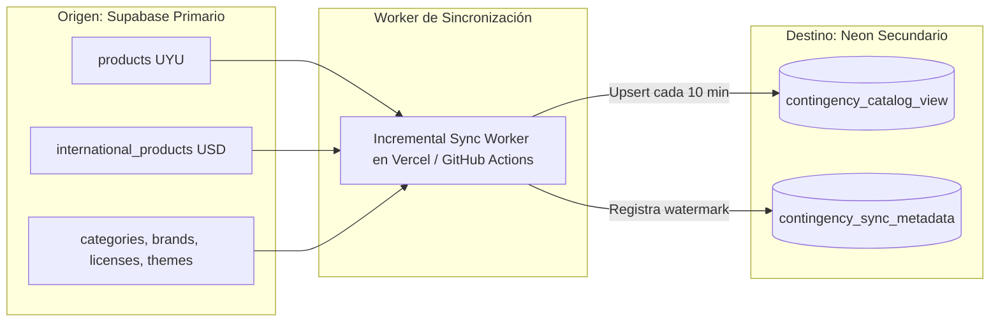
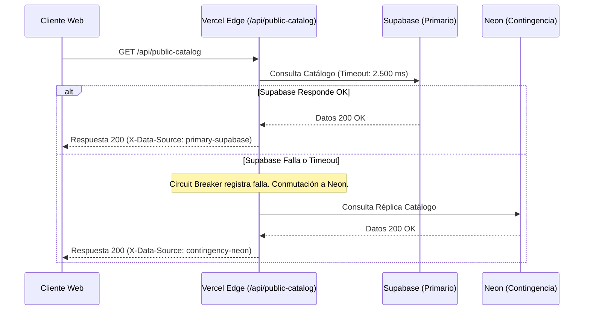

# ARQUITECTURA DE CONTINGENCIA VALIDADA (NEON POSTGRESQL + CLOUDFLARE R2)
**Proyecto:** Collectibles (`collectibles.uy`)  
**Fecha de Emisión:** 18 de octubre de 2026  
**Alcance:** Validación rigurosa de proveedores, sincronización de catálogos multi-moneda (UYU / USD), políticas de imágenes de terceros, latencias y mecanismos de failover.

---

## 1. VALIDACIÓN TÉCNICA DE NEON SERVERLESS POSTGRESQL

### 1.1 Especificaciones y Límites Reales
- **Plan Free ($0 / mes):**
  - **Almacenamiento:** Hasta 1 GB de almacenamiento Postgres (el catálogo de Collectibles ocupa ~35 MB, por lo que cabe holgadamente).
  - **Cómputo:** 100 horas de Compute Unit (CU-hours) al mes.
  - **Autosupensión (Scale-to-Zero):** La base se suspende automáticamente tras **5 minutos de inactividad** para ahorrar recursos.
  - **LATENCIA DE ARRANQUE EN FRÍO (Cold Start):** Cuando llega una consulta tras estar suspendida, el cómputo tarda entre **500 ms y 1.500 ms** en reactivarse.
    - *Aclaración técnica obligatoria:* No se puede prometer una conmutación instantánea de "< 2 ms" en el plan Free; la primera consulta durante una caída experimentará una latencia de ~1 segundo.
- **Plan Launch (Pago por Uso, sin cuota mínima mensual obligatoria):**
  - Cómputo facturado a ~$0,106 USD por CU-hora activa.
  - Almacenamiento a $0,35 USD por GB al mes.
  - Permite mantener la instancia con autosupensión o reactivación más rápida.
- **Connection Pooling:**
  - Neon incluye PgBouncer integrado nativamente que soporta hasta **10.000 conexiones concurrentes**, ideal para el tráfico serverless de Vercel.

---

## 2. MECANISMO DE SINCRONIZACIÓN DEL CATÁLOGO MULTI-MONEDA

Collectibles cuenta con un catálogo heterogéneo:
1. **Productos Locales:** Precios en Pesos Uruguayos (UYU), stock administrado en tienda o por vendedores locales.
2. **Productos Internacionales (Amazon / Zinc API):** Precios base en Dólares (USD), disponibilidad sujeta al stock de Amazon y cálculo de tipo de cambio en tiempo real.



### 2.1 Estrategia de Sincronización Incremental por Marca de Agua (Watermark)
- **Altas y Modificaciones:**
  - Las tablas `products` e `international_products` disponen de la columna `updated_at`.
  - El worker de sincronización consulta cada 10 minutos:
    ```sql
    SELECT id, title, slug, description, base_price, compare_at_price, status, is_active,
           brand_id, category_id, condition, updated_at
    FROM products
    WHERE updated_at > :last_sync_timestamp
    ORDER BY updated_at ASC;
    ```
  - Aplica un `INSERT ... ON CONFLICT (id) DO UPDATE` sobre la base de Neon.
- **Bajas (Eliminaciones):**
  - Para no realizar escaneos completos buscando ausencias, se implementa una tabla liviana de lápidas (*tombstones*) o un trigger de soft-delete en Supabase:
    ```sql
    CREATE TABLE IF NOT EXISTS public.deleted_records_log (
      table_name text NOT NULL,
      record_id uuid NOT NULL,
      deleted_at timestamptz DEFAULT clock_timestamp()
    );
    ```
  - El worker replica las bajas eliminando el registro correspondiente en Neon.
- **Control de Retraso (Replication Lag):**
  - Neon almacena en `contingency_sync_metadata`:
    - `last_sync_at`: Marca temporal de la última sincronización exitosa.
    - `records_transferred`: Cantidad de registros actualizados.
  - Si la última sincronización exitosa tiene **más de 60 minutos de antigüedad**, el router de Vercel sabe que la réplica está desfasada y muestra una advertencia ("Catálogo en modo contingencia").

### 2.2 Resolución de Conflictos y Verdad Única
- **Regla Estricta:** **Supabase es la ÚNICA fuente de la verdad (*Single Source of Truth*).**
- La base de datos de Neon es **100% de solo lectura para la aplicación**.
- Jamás se escriben órdenes ni modificaciones en Neon. Si ambas bases divergen, el worker siempre sobrescribe Neon con el estado de Supabase.

---

## 3. MECANISMO DE FAILOVER Y CIRCUIT BREAKER EN VERCEL EDGE



### Comportamiento del Checkout ante Caídas de Supabase
- **Regla Inviolable:** **Nunca permitir compras sobre una réplica de catálogo.**
- Si Supabase está caído, el endpoint de checkout devuelve una respuesta controlada y elegante:
  ```json
  {
    "status": "degraded_mode",
    "error": "checkout_temporarily_unavailable",
    "message": "Nuestra pasarela de cobros está en mantenimiento preventivo. Tu selección se encuentra guardada de forma segura. Por favor, reintenta en unos instantes."
  }
  ```
- Esto evita ventas con stock desfasado, pagos sin orden registrada o cobros duplicados.

---

## 4. VALIDACIÓN DE CLOUDFLARE R2 Y POLÍTICAS DE IMÁGENES DE TERCEROS

### 4.1 Costos Reales de Cloudflare R2
- **Almacenamiento:** $0,015 USD por GB al mes (10 GB gratuitos incluidos cada mes).
- **Operaciones de Escritura (Clase A):** $4,50 USD por millón (1 millón gratuito al mes).
- **Operaciones de Lectura (Clase B):** $0,36 USD por millón (10 millones gratuitos al mes).
- **Transferencia Saliente (Egress):** **$0,00 USD (CERO COSTO DE ANCHO DE BANDA).**
- **Costo Total Estimado para Collectibles:** **$0 a $1 USD al mes.**

### 4.2 Restricciones Legales y Técnicas de Imágenes de Terceros (Amazon / Mercado Libre)
Es un error técnico asumir que todas las imágenes de la tienda pueden descargarse, guardarse en R2 y redistribuirse libremente:

1. **Imágenes Propias y de Vendedores Locales (`public-assets` en Supabase):**
   - Son propiedad de Collectibles o de sus tiendas oficiales.
   - **Deben sincronizarse y respaldarse al 100% en Cloudflare R2.**
2. **Imágenes de Amazon (vía Zinc API / PAAPI):**
   - Los términos de servicio de la Product Advertising API (PAAPI) de Amazon prohíben almacenar permanentemente imágenes de productos en servidores propios fuera de una ventana de caché de corta duración (típicamente 24 horas), o exigen que las imágenes se sirvan directamente desde los CDNs oficiales de Amazon (`m.media-amazon.com` o `images-na.ssl-images-amazon.com`).
   - **Solución correcta:** En `api/meta-catalog.js` y en el frontend, las URLs de Amazon deben mantenerse apuntando al CDN de Amazon o pasar por un proxy en memoria que respete la caché temporal, sin clonar permanentemente el catálogo fotográfico de Amazon a R2.
3. **Imágenes de Mercado Libre (`http2.mlstatic.com`):**
   - El proxy `/catalog-images/external/http2.mlstatic.com/...` ya reenvía las peticiones a Mercado Libre preservando las cabeceras requeridas.

### 4.3 Cadena de Respaldo para Imágenes en el Proxy
El proxy de imágenes en Vercel resolverá en el siguiente orden de resiliencia:
1. **Cloudflare R2** (Espejo primario rápido y sin costo de egress para fotos locales).
2. **Supabase Storage** (`public-assets`, origen secundario en caso de que R2 no tenga el archivo).
3. **CDNs Oficiales de Proveedores** (para Amazon y Mercado Libre).
4. **Imagen Placeholder Local** (SVG genérico de Collectibles para evitar imágenes rotas o errores 404).
