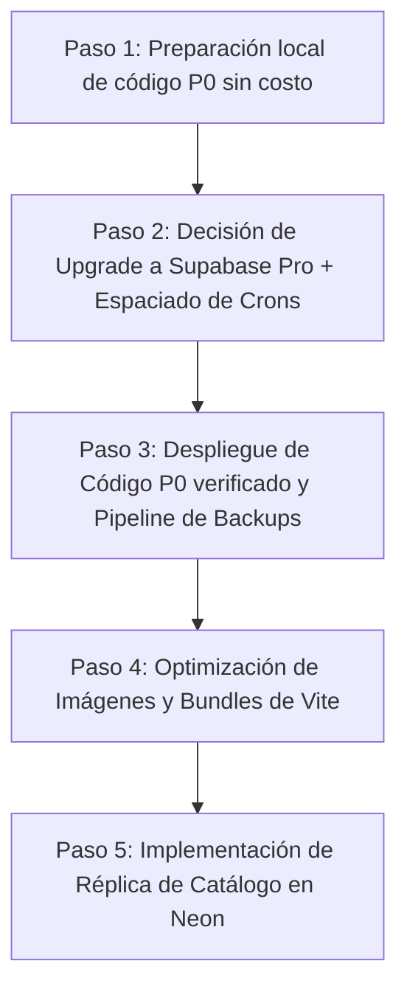

# PLAN DE APROBACIÓN E IMPLEMENTACIÓN POR ETAPAS
**Proyecto:** Collectibles (`collectibles.uy`)  
**Fecha de Emisión:** 18 de octubre de 2026  
**Propósito:** Presentar al propietario de Collectibles una matriz clara y ejecutiva de decisiones, clasificadas por prioridad, impacto, costo y riesgo, distinguiendo aquellas que requieren autorización previa de las que pueden prepararse en desarrollo.

---

## 1. MATRIZ DE DECISIONES Y AUTORIZACIONES REQUERIDAS

| # | Acción Propuesta | Motivo Técnico | Evidencia en Producción | Costo Financiero | Riesgo Operativo | Tiempo Estimado | Requiere Autorización Expresa |
|---|---|---|---|---|---|---|---|
| **1** | **Preparar en rama aislada las correcciones de código P0** (`merchant-feed.js`, Circuit Breaker en `public-catalog.js`). | Evitar que bots y rastreadores disparen escaneos masivos de 1.000 filas sin caché CDN y evitar que demoras en la base emitan errores 503. | Ráfaga de lecturas de `merchant-feed` a las 15:00 UTC previa al congelamiento; errores 503 en catálogo. | **$0 USD** | **Cero** (se desarrolla y prueba en rama local aislada sin tocar producción). | 3 a 4 horas | **NO** (Autorizado para preparación). |
| **2** | **Ajustar el espaciado de tareas en `pg_cron`** (espaciar `ml-sync-queue` de 5 a 15 min, pausar `campaign-runner` de 5 min). | Eliminar la saturación continua donde la base dispara procesos automáticos prácticamente cada minuto del día. | 16 cron jobs identificados; 109 `job startup timeout` en el historial; concurrencia continua comprobada. | **$0 USD** | **Muy Bajo** (no afecta ventas; los carritos y reservas críticas se preservan). | 1 hora | **SÍ (Requiere aprobación del usuario antes de aplicar SQL en producción).** |
| **3** | **Actualizar suscripción de Supabase a Plan Pro ($25) o Pro + Compute Small ($40/mes)**. | Reemplazar la micro-VM Nano de 512 MB de RAM y disco con créditos de ráfaga por una máquina con disco `gp3` de 3.000 IOPS base y 1 GB o 2 GB de RAM. | 454 MB de swap ocupado permanente; 300 pág/s de swap thrashing; cuotas de Egress (5,27/5 GB) y Logs (1,38/1 GB) excedidas. | **$25 a $40 USD / mes** | **Cero riesgo de regresión** (mantiene 100% el mismo código, Auth, Storage y base de datos). | 5 minutos en el panel | **SÍ (Decisión comercial y de facturación exclusiva del usuario).** |
| **4** | **Configurar Pipeline de Backups Diarios Independientes (`pg_dump` cifrado hacia Cloudflare R2 / S3)**. | Garantizar que exista una copia completa y recuperable de esquemas, datos y funciones fuera de la infraestructura de Supabase. | Actualmente los backups dependen 100% de la plataforma de Supabase. | **~$0 a $1 USD / mes** (almacenamiento R2) | **Cero** (el volcado se realiza en modo lectura con timeout estricto). | 4 horas | **SÍ (Para autorizar la creación del bucket y credenciales).** |
| **5** | **Optimizar Imágenes de Catálogo y Separar Bundles de Vite** (selección determinista de imagen principal y aislamiento de `admin-chunk`). | Evitar la descarga de fotos no optimizadas de 1 MB en tarjetas pequeñas y evitar precargar 4,8 MB de JS administrativo en `/shop`. | Foto de Minecraft auditada (927 KB en tarjeta de 220 px); `modulepreload` de `admin-chunk` en HTML público. | **$0 USD** | **Bajo** (requiere validación visual en staging para asegurar que las tarjetas se vean idénticas). | 4 a 6 horas | **SÍ (Para desplegar a producción tras validación).** |
| **6** | **Implementar Base Secundaria de Contingencia en Neon Serverless** (Catálogo desacoplado con conmutación automática). | Permitir que la tienda siga mostrando productos y búsquedas con respuesta 200 aunque Supabase sufra una caída total de infraestructura. | Durante los incidentes, la tienda queda totalmente inaccesible para los compradores. | **$0 USD** (Tier Free) o **~$10-15 USD** (Launch bajo demanda) | **Bajo** (la base secundaria es estrictamente de solo lectura; el checkout entra en modo seguro ante caídas). | 8 a 12 horas | **SÍ (Aprobación de la arquitectura de contingencia).** |

---

## 2. ORDEN DE EJECUCIÓN RECOMENDADO

1. **Paso Inmediato (Hoy, sin costo):**
   - Desarrollar y verificar localmente en una rama aislada las protecciones de [api/merchant-feed.js](file:///c:/Projects/Collectibles2026/api/merchant-feed.js) y el Circuit Breaker de [api/_lib/public-catalog.js](file:///c:/Projects/Collectibles2026/api/_lib/public-catalog.js).
2. **Paso Operativo (Requiere autorización):**
   - El usuario actualiza en el panel de Supabase a **Plan Pro** ($25/mes) y opcionalmente selecciona **Compute Small** (+$15/mes).
   - Se aplica la migración controlada que espacia los cron jobs de fondo (reduciendo 83% de ejecuciones).
3. **Paso de Resiliencia Definitiva (Próximos días):**
   - Configuración de backups externos en Cloudflare R2 y montaje de la base de contingencia de catálogo en Neon.
